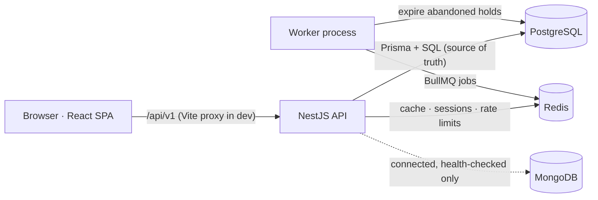
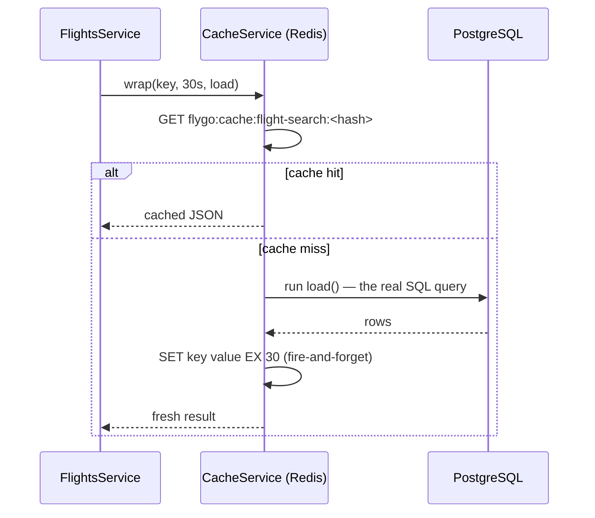
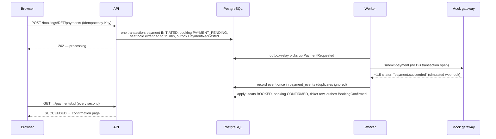
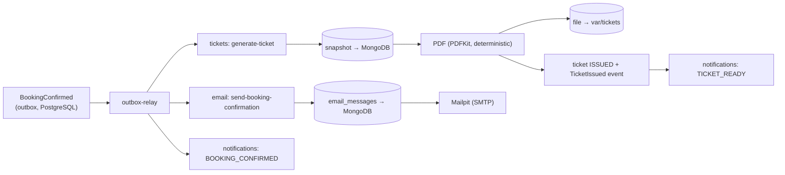

# How FlyGo works — data stores, caching and where the code lives

> A living guide. Each section has a **plain-language** explanation followed by the
> **technical** detail and links to the exact code. Updated at the end of every phase.
> Current state: **end of Phase 7** (search, seats, booking, payments, e-tickets, emails,
> notifications, plus the automated test layers described in §7).

---

## 1. The big picture

**In plain words.** FlyGo has three places where it keeps data, each with a different job:

| Store | Think of it as… | Holds |
|---|---|---|
| **PostgreSQL** | The official ledger. If it's not here, it didn't happen. | Users, airports, flights, fares, every seat, bookings, payments, audit trail |
| **Redis** | A whiteboard next to the ledger: fast, temporary, wiped without harm. | Short-lived caches, login sessions, rate-limit counters, background job queues |
| **MongoDB** | A filing cabinet for documents. | Ticket snapshots, email delivery history, in-app notifications |

The golden rule: **prices, seat availability and bookings are always decided by PostgreSQL**.
Redis may *speed up showing* information, but it never decides anything.

**Technically.**



- The browser never talks to a database. Everything goes through the API at `/api/v1/...`.
  In development the Vite dev server forwards `/api` to port 3000 — see the proxy in
  [`apps/web/vite.config.ts`](../apps/web/vite.config.ts#L11).
- Every API call from the frontend goes through one function,
  [`apiRequest()` in `apps/web/src/api/client.ts`](../apps/web/src/api/client.ts#L69).

---

## 2. What you see before signing in — and where it comes from

| Screen element | Source | Store |
|---|---|---|
| Home hero text, "how it works" steps, header, footer | Hard-coded in the frontend | none |
| "Popular routes" cards | Hard-coded list [`POPULAR` in `HomePage.tsx`](../apps/web/src/pages/HomePage.tsx#L7) — each card is just a link that runs a real search | none |
| Airport suggestions (From / To) | `GET /api/v1/airports` | PostgreSQL, cached in Redis for 1 h |
| Flight results | `GET /api/v1/flights?...` | PostgreSQL, cached in Redis for 30 s |
| Fare per adult on the seat page | `GET /api/v1/flights/:id` | PostgreSQL (not cached) |
| Seat map | `GET /api/v1/flights/:id/seat-map` | PostgreSQL (**never** cached). When signed in it also returns `yourHolds` — your own unexpired holds on that flight, so you can resume or release them |
| Country list on the sign-up page | `GET /api/v1/reference/countries` — a static list in [`countries.ts`](../apps/api/src/common/reference/countries.ts#L2) | none (code) |
| "Am I signed in?" check | `GET /api/v1/auth/me` | Redis session → PostgreSQL user (only if a session exists) |

---

## 3. PostgreSQL — the source of truth

**In plain words.** PostgreSQL stores everything that must be correct: which flights exist,
what they cost, which seat belongs to whom. When two people try to grab the same seat at the
same moment, PostgreSQL itself makes sure only one of them gets it.

**Technically.**

- **Connection:** [`PrismaService`](../apps/api/src/database/prisma.service.ts#L11) — Prisma 7
  with the `pg` driver adapter. One shared connection pool per process.
- **Schema:** [`apps/api/prisma/schema.prisma`](../apps/api/prisma/schema.prisma); extra safety
  rules Prisma can't express (CHECK constraints, partial unique indexes) are in the
  [core migration SQL](../apps/api/prisma/migrations/20261011183639_core_schema/migration.sql).
- **Flight search** — one SQL query joining `flights`, `airlines`, `aircraft`, `flight_fares`
  and a live count of free seats:
  [`FlightsRepository.search()`](../apps/api/src/modules/flights/flights.repository.ts#L54).
  "Free" includes seats whose hold has expired — [`AVAILABLE_SEAT`](../apps/api/src/modules/flights/flights.repository.ts#L39).
- **Price per adult** = base fare from `flight_fares` + rules from `fee_rules` (7.5% tax,
  ₹450 fee), computed by the pure function
  [`calculatePrice()`](../apps/api/src/modules/pricing/price-calculator.ts).
- **Seat map** — [`SeatInventoryRepository.seatMap()`](../apps/api/src/modules/seat-inventory/seat-inventory.repository.ts#L34)
  reads `flight_seats` + `layout_seats` live on every request.
- **Holding seats** — a single atomic SQL update that only succeeds for free seats:
  [`SeatInventoryRepository.hold()`](../apps/api/src/modules/seat-inventory/seat-inventory.repository.ts#L58).
  Explained in depth in the design doc, §9.

> **Small in-memory cache (not Redis):** market and fee-rule *configuration* is kept in the
> API's own memory for 60 seconds —
> [`MarketsService`](../apps/api/src/modules/markets/markets.service.ts#L11). It only stores
> which market a nationality maps to; fares are still read from PostgreSQL.

---

## 4. Redis — how and where it comes into the picture

**In plain words.** Redis is a very fast in-memory store. FlyGo uses it for five things, all
of which are *temporary*. If Redis were wiped, nobody would lose a booking: people would be
signed out, the next search would be a little slower, and background jobs would restart.

All FlyGo keys start with `flygo:` (set once in
[`redis.module.ts`](../apps/api/src/infrastructure/redis/redis.module.ts#L20)), so they never
clash with anything else in Redis.

### 4.1 Caching search results and airports

**Plain:** when someone searches Delhi → Mumbai, the answer is remembered for 30 seconds. If
another person runs the same search within that time, FlyGo answers from Redis instead of
asking PostgreSQL again. The airport list is remembered for an hour because it rarely changes.

**How it works — "cache-aside":**



**Where the code is:**

| What | File |
|---|---|
| The generic cache helper — `wrap()` reads, falls back to the loader, then writes with a TTL | [`cache.service.ts` → `wrap()`](../apps/api/src/infrastructure/cache/cache.service.ts#L24) (read at [line 26](../apps/api/src/infrastructure/cache/cache.service.ts#L26), write at [line 32](../apps/api/src/infrastructure/cache/cache.service.ts#L32)) |
| How cache keys are built (SHA-256 hash of the query, so keys are short and contain no personal data) | [`CacheService.key()`](../apps/api/src/infrastructure/cache/cache.service.ts#L16) |
| Flight search uses it (30 s, key includes the pricing market) | [`flights.service.ts` line 76–78](../apps/api/src/modules/flights/flights.service.ts#L76), TTL constant at [line 15](../apps/api/src/modules/flights/flights.service.ts#L15) |
| Airport list/search uses it (1 h) | [`airports.controller.ts` line 47](../apps/api/src/modules/airports/airports.controller.ts#L47) |

**Safety rules built in:**
- If Redis is down, `wrap()` logs a warning and just queries PostgreSQL — the site keeps working.
- The seat map and seat holds are **never** cached. A cached "seat available" could be wrong,
  so anything that decides who gets a seat always goes straight to PostgreSQL.
- Search results can be up to 30 s old. That's acceptable because the seat map and the hold
  re-check everything live.

### 4.2 Login sessions

**Plain:** when you sign in, the server remembers "this browser belongs to Asha" in Redis.
Your browser only keeps a random ticket number in a cookie (`fg_sid`) that JavaScript can't
read. Signing out deletes the Redis entry, so the ticket stops working instantly.

**Even before signing in**, opening the sign-in page creates a tiny anonymous session holding
only a security token (CSRF token) that protects the sign-in form from forged submissions.

**Where the code is:**

| What | File |
|---|---|
| Session middleware (cookie `fg_sid`, HttpOnly, 30-min idle expiry) | [`session.middleware.ts`](../apps/api/src/modules/auth/session/session.middleware.ts#L12) |
| Our Redis session store — saves (`SET … EX`), refreshes (`EXPIRE`), deletes (`DEL`) `flygo:sess:<id>` | [`redis-session.store.ts`](../apps/api/src/modules/auth/session/redis-session.store.ts#L33) |
| Plugged into every request | [`configure-app.ts` line 18](../apps/api/src/bootstrap/configure-app.ts#L18) |
| CSRF token created and stored in the session | [`auth.controller.ts` → `csrf()`](../apps/api/src/modules/auth/auth.controller.ts#L30) |
| Each request: read session → load the user from PostgreSQL | [`session-auth.guard.ts` → `resolveUser()`](../apps/api/src/modules/auth/guards/session-auth.guard.ts#L35) |
| Frontend fetches the CSRF token automatically | [`client.ts` → `ensureCsrfToken()`](../apps/web/src/api/client.ts#L25) |

The session holds **no personal data** — only a user id, a version number, the sign-in time
and the CSRF token. Roles and names are re-read from PostgreSQL on every request.

### 4.3 Rate limiting

**Plain:** Redis counts how many requests come from each visitor per minute, so nobody can
hammer the login form or grab seats with a bot.

| Limit | Applies to |
|---|---|
| 120 requests / minute per IP | every endpoint (default) — [`rate-limit.ts`](../apps/api/src/modules/auth/rate-limit/rate-limit.ts#L15) |
| 5 / minute per IP + email, 20 / minute per IP | sign-in — [`auth.controller.ts`](../apps/api/src/modules/auth/auth.controller.ts#L50) |
| 5 / hour per IP | sign-up — [`auth.controller.ts`](../apps/api/src/modules/auth/auth.controller.ts#L40) |
| 10 / minute per user | holding seats — [`bookings.controller.ts`](../apps/api/src/modules/bookings/bookings.controller.ts#L45) |

**How:** a counter key `flygo:rl:<rule>:<hashed visitor>:<minute>` is incremented and given an
expiry in one atomic step — [`rate-limiter.service.ts` line 28–29](../apps/api/src/modules/auth/rate-limit/rate-limiter.service.ts#L28).
The guard that applies it to every request is
[`RateLimitGuard`](../apps/api/src/modules/auth/guards/rate-limit.guard.ts#L10), registered
globally in [`auth.module.ts`](../apps/api/src/modules/auth/auth.module.ts#L26).

### 4.4 Background jobs (BullMQ queues)

**Plain:** some work shouldn't happen while you wait — e.g. tidying up abandoned seat holds.
The API (or a timer) drops a "job" into a Redis queue, and the separate **worker** process
picks it up.

| Job | How often | What it does | Code |
|---|---|---|---|
| `worker-heartbeat` | every 10 s | proves the worker is alive (writes `flygo:worker:heartbeat`) | [`maintenance.processor.ts` line 26–28](../apps/api/src/queues/processors/maintenance.processor.ts#L26) |
| `expire-holds` | every 30 s | expires unpaid holds older than 10 min and frees their seats **in PostgreSQL** | [`maintenance.processor.ts` line 31](../apps/api/src/queues/processors/maintenance.processor.ts#L31) → [`hold-expiry.service.ts`](../apps/api/src/modules/seat-inventory/hold-expiry.service.ts) |
| `outbox-relay` | every 1 s | moves committed events (e.g. `PaymentRequested`) from the `outbox_events` table into the right queue | [`outbox-relay.service.ts`](../apps/api/src/modules/outbox/outbox-relay.service.ts), routes in [`outbox-routes.ts`](../apps/api/src/modules/outbox/outbox-routes.ts) |
| `reconcile-payments` | every 2 min | re-sends payments never submitted and asks the gateway about payments stuck "processing" | [`payment-reconciliation.service.ts`](../apps/api/src/modules/payments/payment-reconciliation.service.ts) |

**`payments` queue** (5 at a time, up to 8 retries with exponential back-off) —
[`payments.processor.ts`](../apps/api/src/queues/processors/payments.processor.ts):

| Job | What it does |
|---|---|
| `submit-payment` | sends the payment to the gateway (idempotency key = payment id, so a retry never charges twice) |
| `mock-provider-event` | development only: the mock gateway "calling our webhook" ~1.5 s later |
| `apply-payment-event` | applies a recorded gateway event: confirms the booking on success, returns it to `PENDING` on decline |
| `refund-payment` | refunds a payment that succeeded for seats the booking no longer owns |

**`tickets`** (4 at a time, 6 retries) · **`email`** (5 at a time, 8 retries, back-off from 10 s) ·
**`notifications`** (10 at a time, 5 retries) — processors in
[`apps/api/src/queues/processors/`](../apps/api/src/queues/processors/); what triggers each is in
[`outbox-routes.ts`](../apps/api/src/modules/outbox/outbox-routes.ts).

- Queue setup (Redis connection, key prefix `flygo:bull`, retries):
  [`queues.module.ts`](../apps/api/src/queues/queues.module.ts#L15)
- Timers are registered by [`maintenance.scheduler.ts`](../apps/api/src/queues/schedulers/maintenance.scheduler.ts#L17)
- Redis only carries the *job*; the *result* (booking expired, seats freed) is written to
  PostgreSQL. Losing a job just means the next run 30 s later does the work.
- Phases 5–6 add queues for payments, tickets, emails and notifications.

### 4.5 Health check

`GET /api/v1/health/ready` pings Redis; the admin-only `/health/workers` reads the worker
heartbeat key — [`health.indicators.ts`](../apps/api/src/modules/health/health.indicators.ts#L74).

### 4.6 Redis keys at a glance

| Key pattern | Purpose | Expires after |
|---|---|---|
| `flygo:cache:flight-search:<hash>` | cached search results | 30 s |
| `flygo:cache:airports:<hash>` | cached airport list / search | 1 h |
| `flygo:sess:<session-id>` | login session (or anonymous CSRF session) | 30 min idle |
| `flygo:rl:<rule>:<hash>:<window>` | rate-limit counters | the rule's window |
| `flygo:worker:heartbeat` | last worker heartbeat | 2 min |
| `flygo:bull:maintenance:*` | BullMQ queue data and job schedules | managed by BullMQ |

**See it yourself** (with infra running; Redis asks for `REDIS_PASSWORD` from `.env` — type
`AUTH <password>` at the prompt):

```bash
docker exec -it flygo-redis-1 redis-cli
```

Then, inside `redis-cli`: `SCAN 0 MATCH flygo:* COUNT 100`, `TTL <key>`, `GET <key>`.
Run a flight search in the browser and a `flygo:cache:flight-search:*` key appears; wait
30 seconds and it disappears.

---

## 4.7 Paying for a booking — step by step

**Plain:** pressing *Complete payment* doesn't wait on the card network inside your request.
FlyGo records "a payment has started", tells you it's processing, and the worker finishes the
job in the background — exactly how real gateways (Razorpay, Stripe) work, with their answer
arriving later as a webhook. Your page checks every second and moves on when the answer lands.



**Where things are decided:**

| Concern | Rule | Code |
|---|---|---|
| Price | Computed on the server at checkout from fares + fee rules + passenger types + seats; the browser only sends `priceVersion` | [`checkout.service.ts`](../apps/api/src/modules/bookings/checkout.service.ts) |
| Starting payment | Booking must be `PENDING`, hold valid, price unchanged; one in-flight payment per booking (database index) | [`payment-initiation.service.ts`](../apps/api/src/modules/payments/payment-initiation.service.ts) |
| Duplicate webhooks | Each gateway event is stored once (`UNIQUE provider + event id`); repeats are ignored | [`payment-events.service.ts`](../apps/api/src/modules/payments/payment-events.service.ts) |
| Confirmation | Only if the booking still owns **all** its seats; otherwise release + refund | [`payment-processing.service.ts`](../apps/api/src/modules/payments/payment-processing.service.ts) |
| Swapping in a real gateway | Implement `PaymentProvider` and add a webhook endpoint that calls the same ingest method | [`payment-provider.ts`](../apps/api/src/modules/payments/providers/payment-provider.ts) |

## 5. MongoDB — documents that aren't transactional

**Plain:** MongoDB keeps three kinds of documents that don't need PostgreSQL's strict rules.
It is only ever written by the **worker**, after PostgreSQL has committed the real change, and
every write is "insert once" — so a retried job can never create a duplicate.

| Collection | What it holds | Written when | Unique key | Code |
|---|---|---|---|---|
| `ticket_snapshots` | a frozen copy of exactly what was printed on an e-ticket | the ticket PDF is generated | `bookingId + version` | [`ticket-snapshots.repository.ts`](../apps/api/src/modules/tickets/ticket-snapshots.repository.ts) |
| `email_messages` | each confirmation email and every send attempt (`QUEUED → SENDING → SENT / RETRY_SCHEDULED / FAILED`) | the email job runs | `dedupeKey` (`booking:REF:confirmation:v1`) | [`email-messages.repository.ts`](../apps/api/src/modules/email/email-messages.repository.ts) |
| `notifications` | the bell's notifications and their read state (auto-deleted after 180 days) | a domain event is processed | `dedupeKey` (`TYPE:eventId`) | [`notifications.repository.ts`](../apps/api/src/modules/notifications/notifications.repository.ts) |

Indexes (including the uniques above) are created at start-up by
[`mongo-indexes.service.ts`](../apps/api/src/database/mongo/mongo-indexes.service.ts).
**PostgreSQL stays the source of truth:** the `tickets` table says whether a ticket is issued;
the snapshot only records *what* was printed. If MongoDB is down, jobs retry — bookings are unaffected.

### 5.1 After a booking is confirmed



- The three branches are **separate jobs** — an email failure never delays the ticket, and vice versa.
- The PDF is **deterministic**: the same snapshot always produces identical bytes (checksum stored
  in PostgreSQL). If the file is ever lost, it is rebuilt from the snapshot on the next download.
- Tickets are served only through the API with the owner's session (`private, no-store`); the
  file path is never exposed — [`tickets.controller.ts`](../apps/api/src/modules/tickets/tickets.controller.ts).
- **Safety nets** (maintenance queue): `reconcile-tickets` (every 5 min) and `retry-failed-emails`
  (every 10 min) re-queue any confirmed booking without an issued ticket or a sent email —
  [`delivery-reconciliation.service.ts`](../apps/api/src/queues/reconciliation/delivery-reconciliation.service.ts).
- "SENT" means the SMTP server accepted the email, not that it reached the inbox.

## 6. One search, end to end

1. You press **Search** → the URL becomes `/flights?from=DEL&to=BOM&date=…`.
2. [`useFlightSearch()`](../apps/web/src/api/flights.ts#L79) calls `GET /api/v1/flights?...`.
3. Every request passes the global guards: session lookup in **Redis** → rate-limit counter in
   **Redis** → CSRF check (only for POST/PUT/DELETE) → permission check.
4. [`FlightsService.search()`](../apps/api/src/modules/flights/flights.service.ts) validates the
   airports (**PostgreSQL**), works out the pricing market, and calls the **Redis** cache.
5. On a cache miss, one SQL query in **PostgreSQL** returns the flights, fares and live seat
   counts; prices are calculated; the result is stored in **Redis** for 30 s.
6. The JSON goes back to the browser, which shows each time in the airport's local time.

Clicking **Select seats** then calls the seat-map endpoint, which always reads **PostgreSQL**
directly — no cache — because that screen is about to make a real decision.

## 7. How FlyGo is tested

**In plain words.** There are three layers of automated checks, from small to large:

1. **Unit tests** check single pieces in isolation — e.g. "₹4,500 + 7.5% GST rounds to the right
   paisa", or "a 1:30 AM time that doesn't exist on a DST day is shifted forward".
2. **Integration tests** start the real API in memory and talk to real PostgreSQL, Redis and
   MongoDB — e.g. "50 people grab the same seat at once and exactly one gets it", or "someone
   else's booking reference returns *not found*".
3. **End-to-end tests** open a real (invisible) Chrome browser and use FlyGo like a person would:
   sign up, search, pick a seat, pay, download the ticket, check the email in Mailpit.

None of them ever touch your own data: each layer has its own databases.

**Technical detail.**

| Layer | Command | Runs against | Code |
|---|---|---|---|
| Unit | `npm test` | nothing external | `apps/api/src/**/*.spec.ts`, `apps/web/src/**/*.test.ts` |
| Integration | `npm run test:int` | PostgreSQL `flygo_test` (truncated per test), Redis DB 15, Mongo `flygo_test`, Mailpit | [`apps/api/test/integration`](../apps/api/test/integration) |
| End-to-end | `npm run test:e2e` | PostgreSQL `flygo_e2e` (seeded once, cleaned per run), Redis DB 14, Mongo `flygo_e2e`, Mailpit | [`apps/e2e`](../apps/e2e) |

- **Access-control matrix** —
  [`access-control.int-spec.ts`](../apps/api/test/integration/access-control.int-spec.ts) calls every
  signed-in endpoint as a guest (401), as another customer (404) and without a CSRF token (403).
  Ownership is enforced in the query itself (`WHERE reference = … AND user_id = …`), so a foreign
  booking is indistinguishable from a missing one.
- **E2E servers** — [`playwright.config.ts`](../apps/e2e/playwright.config.ts) starts the built API
  (:3100), the worker and the Vite dev server (:5180), with env from
  [`support/env.ts`](../apps/e2e/support/env.ts). [`global-setup.ts`](../apps/e2e/support/global-setup.ts)
  migrates/seeds `flygo_e2e` and removes the previous run's customers and bookings (releasing
  seats first — a `TRUNCATE … CASCADE` would also wipe the seat inventory).
- **Edge cases without waiting** — hold expiry moves `hold_expires_at` into the past in the
  database ([`support/db.ts`](../apps/e2e/support/db.ts)) and then waits for the real sweeper job.
- **Declines on demand** — the mock gateway declines any booking whose contact email contains
  `+decline` ([`mock-payment.provider.ts`](../apps/api/src/modules/payments/providers/mock-payment.provider.ts)),
  like Stripe's decline test cards. The mock is refused in production by config validation.
